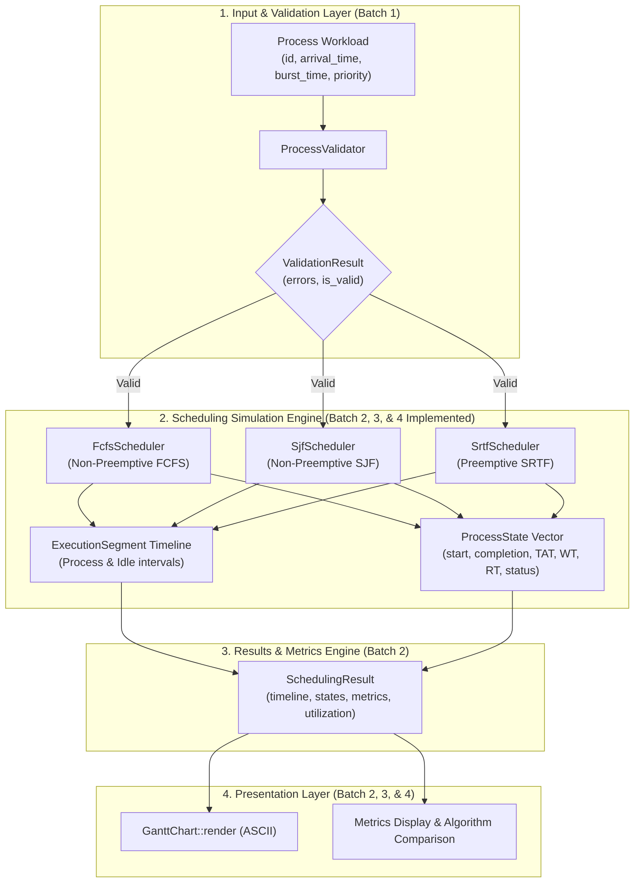

# CPU Scheduling Simulator — Architectural Design

This document details the architectural foundation, component boundaries, and design principles of the **CPU Scheduling Simulator**. It articulates the separation of concerns across implemented foundational models, the FCFS, SJF, and SRTF scheduling engines, and planned future algorithm extensions.

---

## 1. Architectural Philosophy

The core architectural tenet of the simulator is the strict separation between:
1. **Immutable Workload Inputs**: The specification of what arrives and its declared requirements (`Process`).
2. **Mutable Simulation State**: Dynamic execution tracking for individual processes (`ProcessState`).
3. **Execution Timeline & Segments**: The complete chronological trace of CPU activity, including explicit idle intervals (`ExecutionSegment`).
4. **Simulation Results & Analytics**: Deterministic post-execution metrics and aggregate statistics (`SchedulingResult`).
5. **Presentation**: Decoupled visualization renderers (e.g. `GanttChart`).

---

## 2. Component Boundaries & Responsibilities

### 2.1 Process Input Model (`cpu_scheduler::Process`) — **Implemented (Batch 1)**
- **Location**: `include/cpu_scheduler/process.hpp`
- **Role**: Pure data model representing immutable workload input parameters:
  - `id`: Unique identifier (`std::string`).
  - `arrival_time`: Point in simulation time when the process enters the system (`Time = std::int64_t`).
  - `burst_time`: Total CPU execution time required (`Time = std::int64_t`).
  - `priority`: Static scheduling priority (`int`).
- **Invariants & Design Constraints**:
  - The model does not contain mutable simulation fields.
  - The original burst time is preserved and never modified during simulation.

### 2.2 Workload Validation (`cpu_scheduler::ProcessValidator`) — **Implemented (Batch 1)**
- **Location**: `include/cpu_scheduler/process_validator.hpp`
- **Role**: Validates input workloads against simulation integrity rules:
  1. **Non-Empty Workload**: At least one process must be supplied.
  2. **Non-Empty Process ID**: Process IDs must not be empty or whitespace-only.
  3. **Unique Process IDs**: IDs are compared case-insensitively and ignoring surrounding whitespace.
  4. **Non-Negative Arrival Time**: `arrival_time >= 0`.
  5. **Positive Burst Time**: `burst_time > 0`.
- **Invariants & Design Constraints**:
  - Validations do not modify the input process vector.
  - Returns `ValidationResult` containing all detected errors rather than aborting at the first failure.
  - Zero exceptions for standard input validation.

### 2.3 Process Execution State (`cpu_scheduler::ProcessState`) — **Implemented (Batch 2)**
- **Location**: `include/cpu_scheduler/process_state.hpp`
- **Role**: Dynamic execution and performance metrics state for an individual process.
- **Fields**:
  - `process_id`: Identifier corresponding to the input process.
  - `arrival_time`, `burst_time`, `priority`: Copied input parameters.
  - `remaining_time`: Remaining CPU time to execute.
  - `start_time`: Timestamp when the process first received CPU execution.
  - `completion_time`: Timestamp when the process terminated execution.
  - `turnaround_time`: Total time spent in the system ($CT - Arrival Time$).
  - `waiting_time`: Total time spent waiting in the ready queue ($TAT - Burst Time$).
  - `response_time`: Duration from arrival until initial execution ($Start Time - Arrival Time$).
  - `status`: Lifecycle enumeration (`NotStarted`, `Running`, `Completed`).
- **Isolation**: Keeps execution variables completely separate from the original input `Process`.

### 2.4 Execution Timeline (`cpu_scheduler::ExecutionSegment`) — **Implemented (Batch 2)**
- **Location**: `include/cpu_scheduler/execution_segment.hpp`
- **Role**: Represents an atomic contiguous block of CPU time.
- **Fields**:
  - `type`: `SegmentType::Process` or `SegmentType::Idle`.
  - `process_id`: ID of the running process, or `std::nullopt` during CPU idle.
  - `start_time`: Simulation start timestamp.
  - `end_time`: Simulation completion timestamp.
  - `duration()`: Convenience helper ($end\_time - start\_time$).
- **Rules**:
  - CPU idle intervals are recorded explicitly (`SegmentType::Idle`).
  - Zero-length idle intervals are prohibited (e.g., when a process arrives at the exact time the previous finishes).
  - Multiple execution segments for a single process are naturally supported when preemption occurs.

### 2.5 Scheduling Result (`cpu_scheduler::SchedulingResult` & `ScheduleOutcome`) — **Implemented (Batch 2)**
- **Location**: `include/cpu_scheduler/scheduling_result.hpp`
- **Role**: Aggregates the execution timeline, per-process states, and summary metrics. Shared across all scheduling algorithms.
- **Metrics Computed**:
  - `total_execution_time`: Total duration of the simulation ($Busy Time + Idle Time$).
  - `cpu_busy_time`: Sum of burst times across all scheduled processes.
  - `cpu_idle_time`: Sum of all idle interval durations.
  - `cpu_utilization`: $(cpu\_busy\_time / total\_execution\_time) \times 100\%$.
  - `average_waiting_time`: $\sum WT / N$.
  - `average_turnaround_time`: $\sum TAT / N$.
  - `average_response_time`: $\sum RT / N$.
- **Error Distinction**:
  - `ScheduleOutcome` holds either a successful `SchedulingResult` or a `ScheduleError`.
  - Differentiates between input validation failures (`ScheduleErrorKind::ValidationError`) and arithmetic overflows (`ScheduleErrorKind::ArithmeticOverflow`).

### 2.6 FCFS Scheduler (`cpu_scheduler::FcfsScheduler`) — **Implemented (Batch 2)**
- **Location**: `include/cpu_scheduler/fcfs_scheduler.hpp`
- **Role**: Implements non-preemptive First Come, First Served scheduling.
- **Responsibilities**:
  1. Validates the workload using `ProcessValidator`.
  2. Arranges processes by ascending `arrival_time` using stable sort (preserving input order for simultaneous arrivals).
  3. Dispatches processes sequentially to completion.
  4. Inserts explicit CPU idle segments when no process is ready.
  5. Computes per-process metrics and system-wide statistics.
  6. Detects and prevents signed 64-bit integer overflow during time accumulation.
  7. Returns a structured `ScheduleOutcome`.

### 2.7 SJF Scheduler (`cpu_scheduler::SjfScheduler`) — **Implemented (Batch 3)**
- **Location**: `include/cpu_scheduler/sjf_scheduler.hpp`
- **Role**: Implements non-preemptive Shortest Job First scheduling.
- **Dynamic Ready-Queue Selection**:
  - Only processes with $arrival\_time \le current\_time$ are admitted into the ready queue.
  - Selection priority:
    1. Shortest `burst_time`.
    2. Earlier `arrival_time` (tie-breaker).
    3. Original input index (stable tie-breaker).
  - Unarrived processes cannot be selected regardless of burst time.
  - Implemented using an initial $O(n \log n)$ sort by arrival time and a min-priority queue for ready processes. Overall complexity is $O(n \log n)$ time and $O(n)$ space.

### 2.8 SRTF Scheduler (`cpu_scheduler::SrtfScheduler`) — **Implemented (Batch 4)**
- **Location**: `include/cpu_scheduler/srtf_scheduler.hpp`
- **Role**: Implements preemptive Shortest Remaining Time First (SRTF) scheduling.
- **Preemption Rule**:
  - A running process is preempted **if and only if** another ready process has a **strictly smaller** remaining execution time (`competing.remaining_time < running.remaining_time`).
  - Equal remaining times do not cause preemption, preventing unnecessary context switching.
- **Three-Tier Deterministic Tie-Breaking**:
  1. Smallest `remaining_time`.
  2. Earlier `arrival_time`.
  3. Original input sequence index.
- **Event-Driven Engine**:
  - Jumps directly between discrete scheduling events (process arrivals and slice completions).
  - Time complexity: $O(n \log n)$ where $n$ is the number of processes.
  - Space complexity: $O(n)$.
- **Response Time & Waiting Time Invariants**:
  - Response time is recorded strictly at the initial CPU execution timestamp ($RT = \text{First Start Time} - \text{Arrival Time}$), remaining constant across subsequent preemptions.
  - Total waiting time covers all intervals spent in the ready queue ($WT = TAT - BT$).

### 2.9 Gantt Chart Renderer (`cpu_scheduler::GanttChart`) — **Implemented (Batch 2)**
- **Location**: `include/cpu_scheduler/gantt_chart.hpp`
- **Role**: Generates ASCII Gantt charts from `SchedulingResult` or raw `ExecutionSegment` spans.
- **Decoupling**: Contains zero scheduling or simulation logic. Reused identically by FCFS, SJF, and SRTF. Naturally formats multiple execution slices per process and idle intervals.

---

## 3. Future Scheduling Algorithms (Planned for Batches 5+)

The established architecture cleanly facilitates future algorithms by implementing identical signatures (`schedule(std::span<const Process>)` returning `ScheduleOutcome`):
- **Priority Scheduling**: Preemptive and non-preemptive selection using process priority integers.
- **Round Robin (RR)**: Preemptive time-slicing using a configurable quantum.
