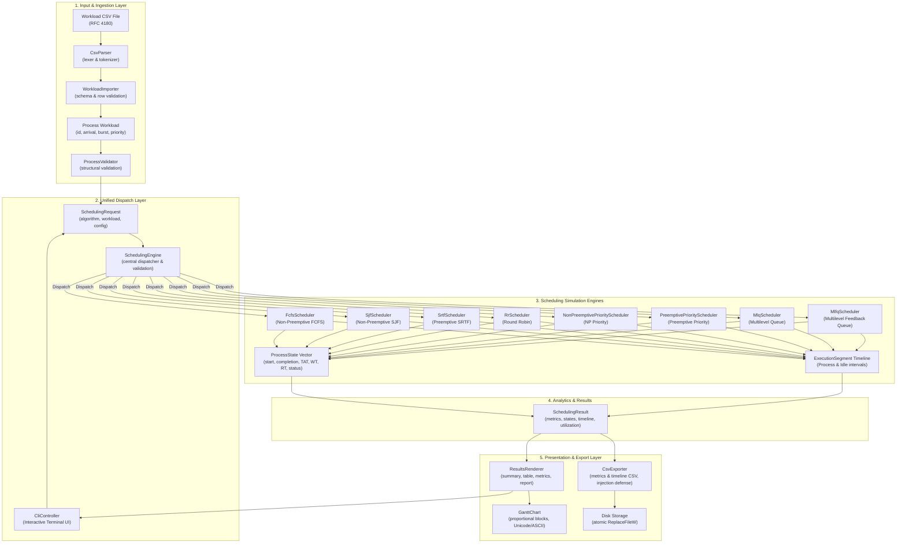

# CPU Scheduling Simulator — Architectural Design

This document details the architectural foundation, component boundaries, and design principles of the **CPU Scheduling Simulator** (C++20). It articulates the separation of concerns across the foundational data models, all eight scheduling engines, the unified dispatch layer, the interactive CLI, the presentation engine, the CSV import/export subsystem, and the integration testing framework.

---

## 1. Architectural Philosophy

The core architectural tenet of the simulator is the strict separation between:
1. **Immutable Workload Inputs**: The specification of what arrives and its declared requirements (`Process`).
2. **Mutable Simulation State**: Dynamic execution tracking for individual processes (`ProcessState`).
3. **Execution Timeline & Segments**: The complete chronological trace of CPU activity, including explicit idle intervals (`ExecutionSegment`).
4. **Simulation Results & Analytics**: Deterministic post-execution metrics and aggregate statistics (`SchedulingResult`).
5. **Unified Engine**: A central dispatcher decoupling user requests from scheduling logic (`SchedulingEngine`).
6. **Presentation**: Decoupled visualization renderers (`ResultsRenderer`, `GanttChart`).
7. **CSV Data Interchange**: RFC 4180 parsing, transactional workload ingestion, and safe spreadsheet export (`CsvParser`, `WorkloadImporter`, `CsvExporter`).
8. **Interactive CLI Application**: Stream-driven terminal user interface (`CliController`).



---

## 2. Component Boundaries & Responsibilities

### 2.1 Process Input Model (`cpu_scheduler::Process`)
- **Location**: `include/cpu_scheduler/process.hpp`
- **Role**: Pure data model representing immutable workload input parameters:
  - `id`: Unique identifier (`std::string`).
  - `arrival_time`: Point in simulation time when the process enters the system (`Time = std::int64_t`).
  - `burst_time`: Total CPU execution time required (`Time = std::int64_t`).
  - `priority`: Static scheduling priority (`int`, smaller numerical value represents higher priority).
- **Invariants & Design Constraints**:
  - Immutable once constructed.
  - The original burst time is preserved and never modified during simulation.
  - Zero and negative priorities are fully valid.

### 2.2 Workload Validation (`cpu_scheduler::ProcessValidator`)
- **Location**: `include/cpu_scheduler/process_validator.hpp`
- **Role**: Validates input workloads against simulation integrity rules:
  1. **Non-Empty Workload**: At least one process must be supplied (up to 100 max).
  2. **Non-Empty Process ID**: Process IDs must not be empty or whitespace-only.
  3. **Unique Process IDs**: IDs are compared case-insensitively and ignoring surrounding whitespace.
  4. **Non-Negative Arrival Time**: `arrival_time >= 0`.
  5. **Positive Burst Time**: `burst_time > 0`.
- **Invariants & Design Constraints**:
  - Accumulates and returns all detected errors in `ValidationResult` rather than aborting on the first failure.
  - Zero exceptions thrown for standard validation errors.

### 2.3 Process Execution State (`cpu_scheduler::ProcessState`)
- **Location**: `include/cpu_scheduler/process_state.hpp`
- **Role**: Dynamic execution tracking and calculated metrics for an individual process.
- **Fields**:
  - `process_id`: Identifier corresponding to the input process.
  - `arrival_time`, `burst_time`, `priority`: Copied input parameters.
  - `remaining_time`: Remaining CPU time to execute.
  - `start_time`: Timestamp when the process first received CPU execution.
  - `completion_time`: Timestamp when the process terminated execution.
  - `turnaround_time`: Elapsed time from arrival to completion ($CT - AT$).
  - `waiting_time`: Total time spent waiting in ready queues ($TAT - BT$).
  - `response_time`: Duration from arrival until initial execution ($Start Time - AT$).
  - `queue_id`: Assigned or final queue identifier.
  - `status`: Lifecycle enumeration (`NotStarted`, `Running`, `Completed`).

### 2.4 Execution Timeline (`cpu_scheduler::ExecutionSegment`)
- **Location**: `include/cpu_scheduler/execution_segment.hpp`
- **Role**: Represents an atomic contiguous block of CPU time.
- **Fields**:
  - `type`: `SegmentType::Process` or `SegmentType::Idle`.
  - `process_id`: ID of the running process, or `std::nullopt` during CPU idle.
  - `start_time`, `end_time`: Simulation boundary timestamps.
  - `duration()`: Convenience helper ($end\_time - start\_time$).
  - `is_idle()`, `is_process()`: Type inspection predicates.
- **Invariants**:
  - Continuous timeline with zero unrecorded gaps: $S_{k+1}.\text{start\_time} == S_k.\text{end\_time}$.
  - Zero-length intervals are prohibited ($start\_time < end\_time$).

### 2.5 Scheduling Result (`cpu_scheduler::SchedulingResult` & `ScheduleOutcome`)
- **Location**: `include/cpu_scheduler/scheduling_result.hpp`
- **Role**: Aggregates the execution timeline, per-process states, and summary metrics. Shared across all scheduling algorithms.
- **Metrics Computed**:
  - `total_execution_time`: Total duration of the simulation ($Busy Time + Idle Time$).
  - `cpu_busy_time`: Sum of burst times across all scheduled processes.
  - `cpu_idle_time`: Sum of all idle interval durations.
  - `cpu_utilization`: $(cpu\_busy\_time / total\_execution\_time) \times 100\%$.
  - `average_waiting_time`, `average_turnaround_time`, `average_response_time`.

### 2.6 FCFS Scheduler (`cpu_scheduler::FcfsScheduler`)
- **Location**: `include/cpu_scheduler/fcfs_scheduler.hpp`
- **Role**: Non-preemptive First Come, First Served scheduling.
- **Key Traits**: Stable sorting by arrival time; sequential non-preemptive dispatch; explicit CPU idle insertion; checked 64-bit integer addition.

### 2.7 SJF Scheduler (`cpu_scheduler::SjfScheduler`)
- **Location**: `include/cpu_scheduler/sjf_scheduler.hpp`
- **Role**: Non-preemptive Shortest Job First scheduling.
- **Dynamic Ready Queue Selection**: Filters arrived candidates dynamically ($AT \le t$). Three-tier tie-breaking: 1. Smallest burst, 2. Earlier arrival, 3. Input sequence index. $O(n \log n)$ time complexity.

### 2.8 SRTF Scheduler (`cpu_scheduler::SrtfScheduler`)
- **Location**: `include/cpu_scheduler/srtf_scheduler.hpp`
- **Role**: Preemptive Shortest Remaining Time First scheduling.
- **Event-Driven Preemption**: Jumps between discrete arrival and completion events. Preempts **if and only if** competing job has strictly smaller remaining burst (`competing.remaining < running.remaining`).

### 2.9 Round Robin Scheduler (`cpu_scheduler::RrScheduler`)
- **Location**: `include/cpu_scheduler/rr_scheduler.hpp`
- **Role**: Preemptive Round Robin scheduling with configurable time quantum ($q$).
- **Queue Semantics**: Strict FIFO queue. New arrivals at quantum expiration timestamp are admitted **before** the preempted process is requeued. Consecutive slices of the same process are merged (timeline normalization).

### 2.10 Priority Schedulers (`NonPreemptivePriorityScheduler` & `PreemptivePriorityScheduler`)
- **Location**: `include/cpu_scheduler/priority_scheduler.hpp`
- **Role**: Non-preemptive and preemptive static priority scheduling.
- **Priority Rules**: Smaller numerical value = higher priority. Preemptive variant preempts only when newly arrived process has strictly higher priority (`new.priority < running.priority`).

### 2.11 Multilevel Queue Scheduler (`cpu_scheduler::MlqScheduler`)
- **Location**: `include/cpu_scheduler/mlq_scheduler.hpp`
- **Role**: Multi-queue partitioning with permanent process-to-queue bindings.
- **Key Traits**: Independent intra-queue algorithms (FCFS, SJF, SRTF, RR, NP Priority, Preemptive Priority); configurable inter-queue policies (`FixedPriorityPreemptive` and `RoundRobin`).

### 2.12 Multilevel Feedback Queue Scheduler (`cpu_scheduler::MlfqScheduler`)
- **Location**: `include/cpu_scheduler/mlfq_scheduler.hpp`
- **Role**: Dynamic priority scheduling with feedback demotion.
- **Key Traits**: Initial admission to Queue 0; dynamic demotion across priority levels upon exhausting level CPU allotment; allotment preserved upon preemption by higher arrivals; periodic starvation boost promoting all uncompleted jobs to Queue 0.

### 2.13 Unified Scheduling Engine (`cpu_scheduler::SchedulingEngine`)
- **Location**: `include/cpu_scheduler/scheduling_engine.hpp`
- **Role**: Type-safe central execution dispatcher.
- **Key Traits**: Single `SchedulingRequest` entry point; `std::variant` configuration container; validation of algorithm-specific configs; introspection helpers (`to_string`, `supported_algorithms`).

### 2.14 Gantt Chart Renderer (`cpu_scheduler::GanttChart`)
- **Location**: `include/cpu_scheduler/gantt_chart.hpp`
- **Role**: Duration-aware text Gantt chart generator.
- **Key Traits**: Proportional block scaling; timestamp boundary alignment under borders; multi-row wrapping; idle block visualization; ASCII and Unicode box-drawing support; queue metadata display.
- **Known Limitation on MLFQ Queue Labels**: `ProcessState::queue_id` stores each process's *final* queue level upon completion. Because individual execution slices in `ExecutionSegment` do not store historical level transitions, MLFQ Gantt charts display process IDs without misleading intermediate queue annotations.

### 2.15 Interactive CLI Controller (`cpu_scheduler::CliController`)
- **Location**: `include/cpu_scheduler/cli.hpp`, `src/cli.cpp`, `src/cli_main.cpp`
- **Role**: Terminal user interface with decoupled stream-based I/O (`std::istream&`, `std::ostream&`).
- **Key Traits**: Interactive menus; field-level validation and recovery loops; safe stream EOF termination; formatted presentation of summaries, tables, Gantt charts, and timelines.

### 2.16 Dedicated Results Presentation Engine (`cpu_scheduler::ResultsRenderer`)
- **Location**: `include/cpu_scheduler/results_renderer.hpp`
- **Role**: Standalone formatting engine composing structured simulation reports.
- **Key Traits**: Modular rendering methods (`render_summary`, `render_process_table`, `render_aggregate_metrics`, `render_timeline`, `render_gantt_chart`, `render_full_report`) with both `std::string` and `std::ostream&` stream interfaces.

### 2.17 CSV Parsing Engine (`cpu_scheduler::CsvParser`)
- **Location**: `include/cpu_scheduler/csv_parser.hpp`
- **Role**: RFC 4180 compliant CSV parser.
- **Key Traits**: Handles quoted fields, escaped quotes (`""`), embedded commas, multi-line fields, CRLF/LF line endings; 1-based syntax diagnostic engine.

### 2.18 Workload Ingestion Engine (`cpu_scheduler::WorkloadImporter`)
- **Location**: `include/cpu_scheduler/workload_importer.hpp`
- **Role**: Ingests CSV files into typed `Process` workloads.
- **Key Traits**: Header alias mapping (`pid`, `at`, `bt`, `prio`, `queue`); all-or-nothing transactional validation; 100-record workload limit.

### 2.19 Results Export Engine (`cpu_scheduler::CsvExporter`)
- **Location**: `include/cpu_scheduler/csv_exporter.hpp`
- **Role**: Exports process execution metrics and chronological timelines to spreadsheet CSVs.
- **Key Traits**: Formula injection mitigation (neutralizes `=`, `+`, `-`, `@` with leading `'`); Windows-safe atomic staged file replacement via `ReplaceFileW`.

### 2.20 Integration & Invariant Testing Framework
- **Location**: `tests/test_scheduling_integration.cpp`, `tests/test_pipeline_integration.cpp`, `tests/test_cli_integration.cpp`
- **Role**: Cross-algorithm integration testing and regression protection.
- **Key Traits**: Universal invariant verification framework testing process conservation, mathematical metric identities, timeline contiguity, and idle intervals across all 8 algorithms; full end-to-end pipeline testing; scripted CLI integration covering Workflows A through I.

---

## 3. Test Organization and Execution

The test suite contains **601 automated GoogleTest unit and integration tests** organized into 20 modular test files:

| Test Source File | Focus Area | Test Count |
| :--- | :--- | :---: |
| `test_process.cpp` | Process data model invariants | 7 |
| `test_process_validator.cpp` | Input validation rules | 16 |
| `test_fcfs_scheduler.cpp` | FCFS scheduler engine | 34 |
| `test_sjf_scheduler.cpp` | Non-preemptive SJF scheduler engine | 52 |
| `test_srtf_scheduler.cpp` | Preemptive SRTF scheduler engine | 63 |
| `test_rr_scheduler.cpp` | Round Robin scheduler engine | 54 |
| `test_priority_scheduler.cpp` | Priority schedulers (NP & Preemptive) | 68 |
| `test_mlq_scheduler.cpp` | Multilevel Queue scheduler engine | 77 |
| `test_mlfq_scheduler.cpp` | Multilevel Feedback Queue scheduler engine | 77 |
| `test_scheduling_engine.cpp` | Unified Scheduling Engine dispatcher | 39 |
| `test_cli.cpp` | Interactive CLI Controller workflows | 24 |
| `test_gantt_chart.cpp` | Duration-aware Gantt chart rendering | 13 |
| `test_results_renderer.cpp` | Results Presentation Engine formatting | 8 |
| `test_csv_parser.cpp` | RFC 4180 CSV Parser | 11 |
| `test_csv_workload_importer.cpp` | CSV Workload Importer | 17 |
| `test_csv_results_exporter.cpp` | CSV Results Exporter & Formula Injection | 8 |
| `test_cli_csv.cpp` | CLI CSV integration workflows | 3 |
| `test_scheduling_integration.cpp` | Universal scheduling invariants & edge cases | 8 |
| `test_pipeline_integration.cpp` | Full end-to-end data pipeline integration | 7 |
| `test_cli_integration.cpp` | Comprehensive scripted CLI workflows (A–I) | 9 |
| **Total Test Count** | **Full Automated Regression Suite** | **601** |

### Executing the Test Suite
Tests are executed via standard CMake Presets:

```powershell
# Run in Debug mode:
ctest --preset debug-test

# Run in Release mode:
ctest --preset release-test
```

---

## 4. Future System Extensions

With the completion of Batch 14 documentation, the core architecture is production-ready. Potential future extensions include:
- **Graphical / Web UI**: A web-based visualizer consuming exported CSV timeline and metrics data.
- **Statistical Benchmark Suite**: Automated comparative performance benchmarking across all 8 algorithms on synthetic workloads.
