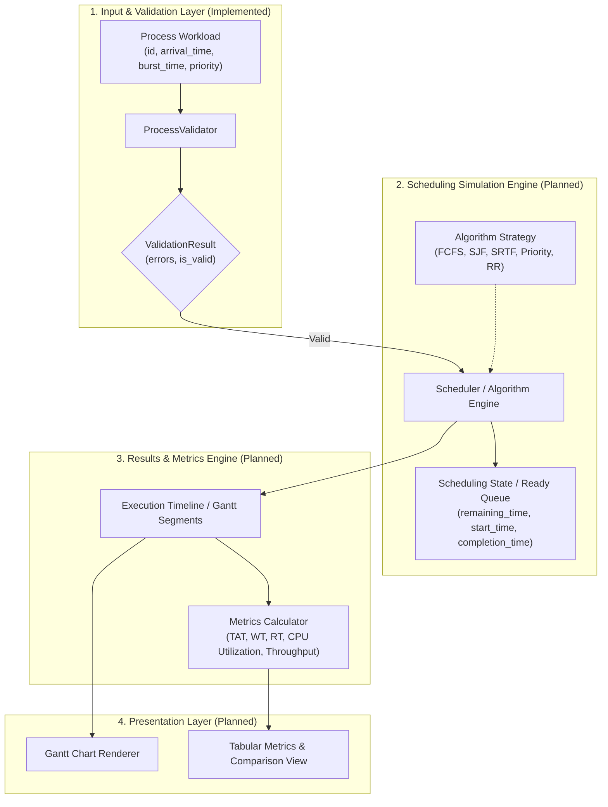

# CPU Scheduling Simulator — Architectural Design

This document details the architectural foundation, component boundaries, and design principles of the **CPU Scheduling Simulator**. It articulates the separation of concerns across implemented foundational models and planned simulation stages.

---

## 1. Architectural Philosophy

The core architectural tenet of the simulator is the strict separation between:
1. **Immutable Workload Inputs**: The specification of what arrives and its declared requirements.
2. **Mutable Simulation State**: The dynamic execution state tracking a process inside an algorithm's scheduling loop.
3. **Execution History & Metrics**: The deterministic trace of scheduling decisions and subsequent statistical analysis.
4. **Presentation & CLI**: Visualization (Gantt charts, tables) and user interaction.

---

## 2. Component Boundaries & Responsibilities

### 2.1 Process Input Model (`cpu_scheduler::Process`) — **Implemented**
- **Location**: `include/cpu_scheduler/process.hpp`
- **Role**: Pure data model representing immutable workload input parameters:
  - `id`: Unique identifier (string).
  - `arrival_time`: Point in simulation time when the process enters the system (`Time = std::int64_t`).
  - `burst_time`: Total CPU execution time required (`Time = std::int64_t`).
  - `priority`: Static scheduling priority (`int`).
- **Invariants & Design Constraints**:
  - The model does not contain mutable simulation fields (e.g., remaining execution time or state flags).
  - The model never stores calculated metrics (e.g., turnaround time, waiting time, completion time).
  - The original burst time is preserved and never modified.

### 2.2 Workload Validation (`cpu_scheduler::ProcessValidator`) — **Implemented**
- **Location**: `include/cpu_scheduler/process_validator.hpp`
- **Role**: Validates input workloads against simulation integrity rules:
  1. **Non-Empty Workload**: At least one process must be supplied.
  2. **Non-Empty Process ID**: Process IDs must not be empty or whitespace-only.
  3. **Unique Process IDs**: IDs are compared case-insensitively and ignoring surrounding whitespace.
  4. **Non-Negative Arrival Time**: `arrival_time >= 0`.
  5. **Positive Burst Time**: `burst_time > 0`.
- **Invariants & Design Constraints**:
  - Validations do not modify the input process vector.
  - Returns `ValidationResult` containing all detected errors rather than aborting at the first failure.
  - Does not use C++ exceptions for standard validation failures.

---

### 2.3 Process Scheduling State (`ProcessState`) — **Planned (Batch 2)**
- **Role**: Runtime representation of a process actively being scheduled.
- **Planned Fields**:
  - Reference or pointer to the original immutable `Process`.
  - `remaining_time`: Decremented as the process is allocated CPU cycles.
  - `first_execution_time`: Simulation timestamp when the process first ran (for Response Time).
  - `completion_time`: Simulation timestamp when the process finished its execution.
  - `state`: Current lifecycle state (`READY`, `RUNNING`, `WAITING`, `TERMINATED`).
- **Isolation**: Prevents mutating the original workload, allowing repeated or comparative simulations across multiple algorithms with identical inputs.

### 2.4 Scheduling Algorithms (`SchedulerStrategy`) — **Planned (Batch 2 / 3)**
- **Algorithms**:
  - **FCFS** (First Come First Served): Non-preemptive, FIFO order based on arrival time.
  - **SJF** (Shortest Job First): Non-preemptive, selects available process with smallest burst time.
  - **SRTF** (Shortest Remaining Time First): Preemptive, selects process with shortest remaining burst time.
  - **Priority Scheduling**: Preemptive and non-preemptive variants based on process priority integer.
  - **Round Robin (RR)**: Preemptive, time-sliced execution with configurable quantum.
- **Interface Contract**: Takes `std::span<const Process>` and parameters (e.g., time quantum), and yields a deterministic execution timeline.

### 2.5 Execution History & Gantt Chart Rendering — **Planned**
- **Schedule Timeline**: An ordered sequence of execution intervals `[start_time, end_time, process_id]`, including CPU idle intervals.
- **Gantt Chart Renderer**: Transforms execution intervals into visual ASCII/ANSI timeline representations.

### 2.6 Metrics Calculation — **Planned**
- **Per-Process Metrics**:
  - **Completion Time ($CT$)**: Simulation time at which execution terminates.
  - **Turnaround Time ($TAT$)**: $TAT = CT - Arrival Time$.
  - **Waiting Time ($WT$)**: $WT = TAT - Burst Time$.
  - **Response Time ($RT$)**: $RT = First Execution Time - Arrival Time$.
- **System Metrics**:
  - Average Turnaround Time, Average Waiting Time, Average Response Time.
  - CPU Utilization percentage.
  - Throughput (processes completed per unit time).

### 2.7 CLI Interface — **Planned**
- Interactive command-line and batch runner allowing users to specify workloads (via manual entry or file inputs), select scheduling algorithms, view step-by-step Gantt charts, and compare algorithm performance metrics side by side.

---

## 3. Technology Stack & Design Decisions

| Aspect | Choice | Justification |
| :--- | :--- | :--- |
| **Language** | C++20 | Modern type safety, ``, designated initializers, spaceship comparison, concepts. |
| **Integer Width** | `std::int64_t` (`Time`) | Eliminates 32-bit overflow concerns during extensive simulation runs. |
| **Error Handling** | Value-based `ValidationResult` | Predictable, composable, zero-cost error collection without control-flow exceptions. |
| **Build System** | CMake 3.20+ with Presets | Standardized, cross-platform build orchestration with out-of-source builds. |
| **Package Manager** | vcpkg (Manifest Mode) | Reproducible, version-locked dependencies (`gtest`). |
| **Testing** | GoogleTest (gtest) | Industry-standard C++ testing framework with granular test discovery. |
