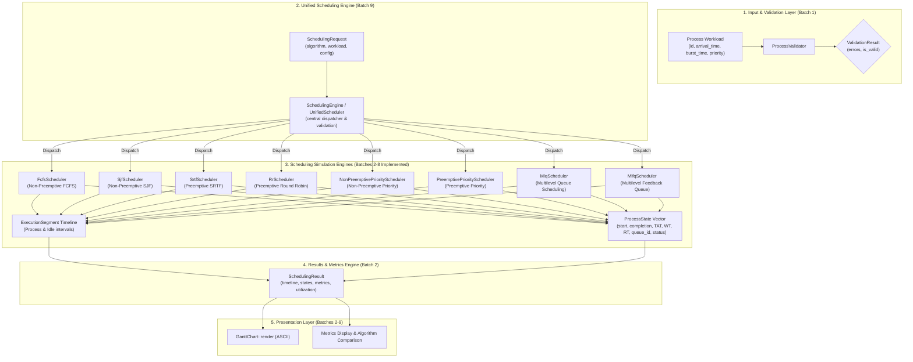

# CPU Scheduling Simulator — Architectural Design

This document details the architectural foundation, component boundaries, and design principles of the **CPU Scheduling Simulator**. It articulates the separation of concerns across implemented foundational models, the FCFS, SJF, SRTF, Round Robin, and Priority scheduling engines, and planned future algorithm extensions.

---

## 1. Architectural Philosophy

The core architectural tenet of the simulator is the strict separation between:
1. **Immutable Workload Inputs**: The specification of what arrives and its declared requirements (`Process`).
2. **Mutable Simulation State**: Dynamic execution tracking for individual processes (`ProcessState`).
3. **Execution Timeline & Segments**: The complete chronological trace of CPU activity, including explicit idle intervals (`ExecutionSegment`).
4. **Simulation Results & Analytics**: Deterministic post-execution metrics and aggregate statistics (`SchedulingResult`).
5. **Presentation**: Decoupled visualization renderers (e.g. `GanttChart`).

---

## 2. Component Boundaries & Responsibilities

### 2.1 Process Input Model (`cpu_scheduler::Process`) — **Implemented (Batch 1)**
- **Location**: `include/cpu_scheduler/process.hpp`
- **Role**: Pure data model representing immutable workload input parameters:
  - `id`: Unique identifier (`std::string`).
  - `arrival_time`: Point in simulation time when the process enters the system (`Time = std::int64_t`).
  - `burst_time`: Total CPU execution time required (`Time = std::int64_t`).
  - `priority`: Static scheduling priority (`int`, smaller numerical value represents higher priority).
- **Invariants & Design Constraints**:
  - The model does not contain mutable simulation fields.
  - The original burst time is preserved and never modified during simulation.
  - Zero and negative priorities are fully valid.

### 2.2 Workload Validation (`cpu_scheduler::ProcessValidator`) — **Implemented (Batch 1)**
- **Location**: `include/cpu_scheduler/process_validator.hpp`
- **Role**: Validates input workloads against simulation integrity rules:
  1. **Non-Empty Workload**: At least one process must be supplied.
  2. **Non-Empty Process ID**: Process IDs must not be empty or whitespace-only.
  3. **Unique Process IDs**: IDs are compared case-insensitively and ignoring surrounding whitespace.
  4. **Non-Negative Arrival Time**: `arrival_time >= 0`.
  5. **Positive Burst Time**: `burst_time > 0`.
- **Invariants & Design Constraints**:
  - Validations do not modify the input process vector.
  - Returns `ValidationResult` containing all detected errors rather than aborting at the first failure.
  - Zero exceptions for standard input validation.

### 2.3 Process Execution State (`cpu_scheduler::ProcessState`) — **Implemented (Batch 2)**
- **Location**: `include/cpu_scheduler/process_state.hpp`
- **Role**: Dynamic execution and performance metrics state for an individual process.
- **Fields**:
  - `process_id`: Identifier corresponding to the input process.
  - `arrival_time`, `burst_time`, `priority`: Copied input parameters.
  - `remaining_time`: Remaining CPU time to execute.
  - `start_time`: Timestamp when the process first received CPU execution.
  - `completion_time`: Timestamp when the process terminated execution.
  - `turnaround_time`: Total time spent in the system ($CT - Arrival Time$).
  - `waiting_time`: Total time spent waiting in the ready queue ($TAT - Burst Time$).
  - `response_time`: Duration from arrival until initial execution ($Start Time - Arrival Time$).
  - `status`: Lifecycle enumeration (`NotStarted`, `Running`, `Completed`).
- **Isolation**: Keeps execution variables completely separate from the original input `Process`.

### 2.4 Execution Timeline (`cpu_scheduler::ExecutionSegment`) — **Implemented (Batch 2)**
- **Location**: `include/cpu_scheduler/execution_segment.hpp`
- **Role**: Represents an atomic contiguous block of CPU time.
- **Fields**:
  - `type`: `SegmentType::Process` or `SegmentType::Idle`.
  - `process_id`: ID of the running process, or `std::nullopt` during CPU idle.
  - `start_time`: Simulation start timestamp.
  - `end_time`: Simulation completion timestamp.
  - `duration()`: Convenience helper ($end\_time - start\_time$).
  - `is_idle()`: Predicate checking whether the segment represents CPU idle.
  - `is_process()`: Predicate checking whether the segment represents process execution.
- **Rules**:
  - CPU idle intervals are recorded explicitly (`SegmentType::Idle`).
  - Zero-length intervals are prohibited.
  - Multiple execution segments for a single process are naturally supported when preemption occurs.

### 2.5 Scheduling Result (`cpu_scheduler::SchedulingResult` & `ScheduleOutcome`) — **Implemented (Batch 2)**
- **Location**: `include/cpu_scheduler/scheduling_result.hpp`
- **Role**: Aggregates the execution timeline, per-process states, and summary metrics. Shared across all scheduling algorithms.
- **Metrics Computed**:
  - `total_execution_time`: Total duration of the simulation ($Busy Time + Idle Time$).
  - `cpu_busy_time`: Sum of burst times across all scheduled processes.
  - `cpu_idle_time`: Sum of all idle interval durations.
  - `cpu_utilization`: $(cpu\_busy\_time / total\_execution\_time) \times 100\%$.
  - `average_waiting_time`: $\sum WT / N$.
  - `average_turnaround_time`: $\sum TAT / N$.
  - `average_response_time`: $\sum RT / N$.
- **Error Distinction**:
  - `ScheduleOutcome` holds either a successful `SchedulingResult` or a `ScheduleError`.
  - Differentiates between input validation failures (`ScheduleErrorKind::ValidationError`) and arithmetic overflows (`ScheduleErrorKind::ArithmeticOverflow`).

### 2.6 FCFS Scheduler (`cpu_scheduler::FcfsScheduler`) — **Implemented (Batch 2)**
- **Location**: `include/cpu_scheduler/fcfs_scheduler.hpp`
- **Role**: Implements non-preemptive First Come, First Served scheduling.
- **Responsibilities**:
  1. Validates the workload using `ProcessValidator`.
  2. Arranges processes by ascending `arrival_time` using stable sort (preserving input order for simultaneous arrivals).
  3. Dispatches processes sequentially to completion.
  4. Inserts explicit CPU idle segments when no process is ready.
  5. Computes per-process metrics and system-wide statistics.
  6. Detects and prevents signed 64-bit integer overflow during time accumulation.
  7. Returns a structured `ScheduleOutcome`.

### 2.7 SJF Scheduler (`cpu_scheduler::SjfScheduler`) — **Implemented (Batch 3)**
- **Location**: `include/cpu_scheduler/sjf_scheduler.hpp`
- **Role**: Implements non-preemptive Shortest Job First scheduling.
- **Dynamic Ready-Queue Selection**:
  - Only processes with $arrival\_time \le current\_time$ are admitted into the ready queue.
  - Selection priority:
    1. Shortest `burst_time`.
    2. Earlier `arrival_time` (tie-breaker).
    3. Original input index (stable tie-breaker).
  - Unarrived processes cannot be selected regardless of burst time.
  - Implemented using an initial $O(n \log n)$ sort by arrival time and a min-priority queue for ready processes. Overall complexity is $O(n \log n)$ time and $O(n)$ space.

### 2.8 SRTF Scheduler (`cpu_scheduler::SrtfScheduler`) — **Implemented (Batch 4)**
- **Location**: `include/cpu_scheduler/srtf_scheduler.hpp`
- **Role**: Implements preemptive Shortest Remaining Time First (SRTF) scheduling.
- **Preemption Rule**:
  - A running process is preempted **if and only if** another ready process has a **strictly smaller** remaining execution time (`competing.remaining_time < running.remaining_time`).
  - Equal remaining times do not cause preemption, preventing unnecessary context switching.
- **Three-Tier Deterministic Tie-Breaking**:
  1. Smallest `remaining_time`.
  2. Earlier `arrival_time`.
  3. Original input sequence index.
- **Event-Driven Engine**:
  - Jumps directly between discrete scheduling events (process arrivals and slice completions).
  - Time complexity: $O(n \log n)$ where $n$ is the number of processes.
  - Space complexity: $O(n)$.

### 2.9 Round Robin Scheduler (`cpu_scheduler::RrScheduler`) — **Implemented (Batch 5)**
- **Location**: `include/cpu_scheduler/rr_scheduler.hpp`
- **Role**: Implements preemptive Round Robin (RR) scheduling with a configurable time quantum.
- **Queue Semantics & Quantum Expiration**:
  - Maintains a strict FIFO ready queue.
  - Each process executes for at most the positive time quantum: $\text{slice} = \min(q, \text{remaining\_burst})$.
  - When a quantum expires, any processes arriving at that timestamp are admitted into the ready queue **before** the preempted process is requeued.
  - If a process finishes its execution, it is permanently marked completed and never requeued.
- **Timeline Normalization**:
  - If a process finishes its quantum and no competing process is ready, it retains the CPU.
  - Consecutive execution slices for the same process are normalized into a continuous execution segment, avoiding artificial timeline fragments.
- **Complexity**: $O(n \log n + \frac{\text{Total Burst}}{q})$ time and $O(n + \frac{\text{Total Burst}}{q})$ timeline segment space.

### 2.10 Priority Schedulers (`cpu_scheduler::NonPreemptivePriorityScheduler` & `PreemptivePriorityScheduler`) — **Implemented (Batch 6)**
- **Location**: `include/cpu_scheduler/priority_scheduler.hpp`, `src/priority_scheduler.cpp`
- **Role**: Implements both non-preemptive and preemptive priority-based scheduling.
- **Priority Direction**:
  - Smaller numerical priority value indicates strictly higher scheduling priority ($1 > 2$, $-5 > 0$).
  - Relational comparisons (`>`) are used directly without subtractions, avoiding signed integer overflow.
- **Deterministic Tie-Breaking Rules**:
  1. Highest priority (smallest numerical value).
  2. Earlier arrival time.
  3. Original input index.
- **Non-Preemptive Priority Scheduler**:
  - Admitted ready processes are ordered by priority. The highest-priority ready process executes to completion uninterrupted.
  - Complexity: $O(n \log n)$ time, $O(n)$ space.
- **Preemptive Priority Scheduler**:
  - Event-driven discrete simulation jumping between arrivals and completions.
  - Preemption Rule: The active process is preempted **if and only if** a newly arrived process has a **strictly higher priority** (`new_proc.priority < running_proc.priority`).
  - Equal-priority arrivals do not preempt the running process.
  - Lower-priority arrivals do not preempt the running process.
  - Preempted processes return to the ready pool with their remaining burst time preserved.
  - Number of preemptions is bounded by $n$, yielding an exact time complexity of $O(n \log n)$ and auxiliary space of $O(n)$ (at most $2n - 1$ timeline segments).
- **Starvation Limitation & Aging Considerations**:
  - Fixed-priority scheduling inherently suffers from starvation of lower-priority processes when higher-priority processes arrive continuously.
  - Priority aging (gradually incrementing priority of waiting processes) is intentionally out of scope for Batch 6 and will be implemented in future batches.

### 2.11 Multilevel Queue Scheduler (`cpu_scheduler::MlqScheduler`) — **Implemented (Batch 7)**
- **Location**: `include/cpu_scheduler/mlq_scheduler.hpp`, `src/mlq_scheduler.cpp`
- **Role**: Implements Multilevel Queue (MLQ) scheduling with multiple distinct ready queues.
- **Architectural Tenets**:
  1. **Permanent Process-to-Queue Assignment**: Each process is bound to exactly one queue (`MlqProcessBinding`) throughout the simulation. No inter-queue migration or aging occurs (strictly separated from MLFQ).
  2. **Decoupled Queue vs. Process Priority**: Queue priority governs inter-queue CPU allocation (smaller numerical value = higher queue priority). Process priority governs intra-queue selection for priority-based queue algorithms.
  3. **Configurable Inter-Queue Policies**:
     - `InterQueuePolicy::FixedPriorityPreemptive`: The ready queue with the highest priority executes; arrivals in higher-priority queues trigger immediate preemption.
     - `InterQueuePolicy::RoundRobin`: Cycles through non-empty queues with an inter-queue time quantum ($Q_{\text{inter}}$).
  4. **Supported Intra-Queue Algorithms**: FCFS, Non-preemptive SJF, Preemptive SRTF, Round Robin (with internal quantum $q_{\text{internal}}$), Non-preemptive Priority, Preemptive Priority.
  5. **Two-Level Quantum Interaction**: In nested Round Robin configurations, the internal slice and inter-queue slice decrease concurrently. State preservation allows an interrupted process to resume its remaining internal slice upon queue re-entry.
  6. **Timeline Normalization**: Merges consecutive slices of the same process into unbroken execution segments.
- **Complexity**: $O(N \log N + K \cdot E)$ for Fixed Priority; $O(N \log N + \frac{B}{Q} \cdot K)$ for Round Robin between queues.

### 2.12 Multilevel Feedback Queue Scheduler (`cpu_scheduler::MlfqScheduler`) — **Implemented (Batch 8)**
- **Location**: `include/cpu_scheduler/mlfq_scheduler.hpp`, `src/mlfq_scheduler.cpp`
- **Role**: Implements Multilevel Feedback Queue (MLFQ) scheduling with dynamic process movement across priority queues.
- **Architectural Tenets & Mechanisms**:
  1. **Dynamic Queue Movement vs. Permanent Binding**: Unlike MLQ where processes are statically assigned to queues, MLFQ automatically migrates processes based on CPU consumption.
  2. **Initial Placement**: Every newly arriving process unconditionally enters Queue 0 (the highest-priority queue).
  3. **Strict Priority Hierarchy**: Queue 0 is the highest priority; Queue $L-1$ is the lowest. A process at level $k$ is only scheduled if queues $0 \dots k-1$ are empty.
  4. **Dynamic Demotion via Level Allotment**:
     - Each queue level $l$ defines a `time_quantum` and an optional `cpu_allotment` (defaulting to the quantum).
     - When a process accumulates CPU execution at level $l$ equal to that level's allotment, it is demoted to level $l+1$ and appended to the back of the queue.
     - Bottom-level processes stay at the bottom level upon allotment expiration, rotating to the back of the queue.
  5. **Allotment Tracking & Preemption Preservation**:
     - When a process running at level $l > 0$ is preempted by a higher-priority arrival into Queue 0, its consumed allotment and remaining quantum at level $l$ are **not** reset.
     - The preempted process stays at the head of level $l$ (`push_front`) so it can resume immediately when higher queues empty.
  6. **Periodic Priority Boosting**:
     - Prevents starvation of CPU-bound processes. Every `boost_interval` time units ($t = k \times \text{boost\_interval}$), all uncompleted processes are promoted to Queue 0.
     - Upon boost, all queue levels are cleared, remaining allotments and quantums are reset to level 0 defaults, and processes are queued in Queue 0 sorted deterministically by earlier arrival time, broken by earlier input workload index.
     - Boost interrupts an executing process at the exact boost timestamp, closing the active timeline segment.
  7. **Deterministic Tie-Breaking & Event Ordering**:
     - Deterministic multi-tier ordering: 1. Queue level ($0 < 1 < \dots < L-1$), 2. Queue FIFO position, 3. Earlier arrival time, 4. Workload input sequence index.
     - Event processing priority at timestamp $t$: 1. Boost event, 2. Process arrivals, 3. Quantum/allotment expiration.
  8. **Timeline Normalization & Overflow Safety**:
     - Consecutive slices of the same process are merged into single continuous timeline segments.
     - All timestamp increments and allotment summations use checked arithmetic (`safe_add`).
- **Complexity**: $O(N \log N + \frac{\text{Total Burst}}{\min(q)} + K_{\text{boost}} \cdot N \log N)$ time and $O(N + \frac{\text{Total Burst}}{\min(q)})$ space.

### 2.13 Unified Scheduling Engine (`cpu_scheduler::SchedulingEngine` / `UnifiedScheduler`) — **Implemented (Batch 9)**
- **Location**: `include/cpu_scheduler/scheduling_engine.hpp`, `src/scheduling_engine.cpp`
- **Role**: Common facade and central dispatcher decoupling callers from underlying scheduler specifics.
- **Architectural Responsibilities**:
  1. **Algorithm Selection**: `enum class SchedulingAlgorithm` strictly differentiates all 8 algorithm implementations.
  2. **Type-Safe Request Container**: `SchedulingRequest` encapsulates algorithm selection, input workload, and algorithm-specific configuration in `std::variant<std::monostate, RoundRobinConfig, MlqWorkload, MlfqConfig>`.
  3. **Configuration Routing & Validation**:
     - Enforces that non-configurable algorithms receive `std::monostate` and rejects irrelevant configuration.
     - Validates that Round Robin receives positive quantum via `RoundRobinConfig`.
     - Validates that MLQ receives `MlqWorkload` and MLFQ receives `MlfqConfig`.
  4. **Zero Duplication & Full Compatibility**: Directly executes existing schedulers and preserves structured outcomes (`ScheduleOutcome`, `SchedulingResult`, `ScheduleError`).
  5. **Introspection Helpers**: Provides reflection and string conversion utilities (`to_string`, `algorithm_name`, `algorithm_from_string`, `supported_algorithms`).

### 2.14 Gantt Chart Renderer (`cpu_scheduler::GanttChart`) — **Enhanced (Batch 11)**
- **Location**: `include/cpu_scheduler/gantt_chart.hpp`, `src/gantt_chart.cpp`
- **Role**: Generates text-based Gantt charts from `SchedulingResult` or raw `ExecutionSegment` spans.
- **Architectural Responsibilities**:
  1. **Duration-Aware Proportional Widths**: Scales block widths based on execution slice duration relative to minimum duration, clamped between `min_block_width` and `max_block_width`.
  2. **Timestamp Axis Alignment**: Accurately places timestamps directly beneath block boundary markers (`+` or `|`), preventing numeric displacement across long or varied durations.
  3. **Multi-Row Wrapping**: Automatically wraps long schedules onto consecutive rows when accumulated line width reaches `max_row_width` (default 80 columns), preserving continuous timeline readability.
  4. **Idle Interval Visualization**: Explicitly displays CPU idle gaps with proportional widths and clear start/finish boundary timestamps.
  5. **Preemption Support**: Seamlessly renders repeated execution slices belonging to the same process.
  6. **Queue Metadata Support**: Includes queue metadata (e.g. `P1 [Q0]`) when available and enabled.
  7. **Border Styling**: Configurable ASCII (`+`, `-`, `|`) and Unicode box-drawing character modes.
  8. **Decoupling**: Contains zero scheduling or simulation logic. Reused identically across all scheduling algorithms.

### 2.15 Interactive CLI Controller (`cpu_scheduler::CliController`) — **Implemented (Batch 10)**
- **Location**: `include/cpu_scheduler/cli.hpp`, `src/cli.cpp`, `src/cli_main.cpp`
- **Role**: Presentation and application layer providing an interactive terminal interface for the simulator.
- **Architectural Responsibilities**:
  1. **Decoupled Stream-Based I/O**: Interacts strictly through `std::istream&` and `std::ostream&`, enabling complete headless automated testing via standard string streams.
  2. **Unified Scheduling Engine Integration**: Binds user selections exclusively to `SchedulingRequest` and dispatches via `SchedulingEngine::execute`, with zero scheduling algorithm reimplementation.
  3. **Field-Level Validation & Retry**: Implements field-by-field validation loops for process IDs (uniqueness, whitespace), non-negative arrival times, positive burst times, priorities, queue assignments, and algorithm configurations.
  4. **Graceful Stream & Error Handling**: Seamlessly detects EOF without entering infinite loops, avoids stream corruption, prevents numeric overflows via checked parsers, and presents structured validation error diagnostics.
  5. **Rich Text Formatting & Gantt Visualization**: Formats simulation banners, main menus, simulation summaries, aligned tabular process execution states, aggregate metrics, chronological execution timelines, and automatic Gantt chart display.

### 2.16 Dedicated Results Presentation Engine (`cpu_scheduler::ResultsRenderer`) — **Implemented (Batch 11)**
- **Location**: `include/cpu_scheduler/results_renderer.hpp`, `src/results_renderer.cpp`
- **Role**: Standalone formatting engine responsible for turning `SchedulingResult` into structured presentation reports.
- **Architectural Responsibilities**:
  1. **Modular Components**: Exposes dedicated rendering methods for Simulation Summary (`render_summary`), Process Table (`render_process_table`), Aggregate Metrics (`render_aggregate_metrics`), Execution Timeline (`render_timeline`), and Gantt Chart (`render_gantt_chart`).
  2. **Full Report Composition**: `render_full_report` composes all components into a complete, presentation-ready report with configurable inclusion options via `RenderOptions`.
  3. **Dual String & Stream Interfaces**: Every rendering method is provided as both an `std::string` returning function and a stream-writing overload (`std::ostream&`), preventing unnecessary string allocations for large simulations.
  4. **Strict Decoupling**: Free of scheduler internals, execution engines, or terminal UI control logic.

### 2.17 CSV Parsing Engine (`cpu_scheduler::CsvParser`) — **Implemented (Batch 12)**
- **Location**: `include/cpu_scheduler/csv_parser.hpp`, `src/csv_parser.cpp`
- **Role**: Reusable RFC 4180 compliant CSV document parser.
- **Architectural Responsibilities**:
  1. **Standard RFC 4180 Parsing**: Handles quoted fields, embedded commas, escaped quotes (`""`), multi-line fields, CRLF and LF line endings, empty fields, and missing trailing newlines.
  2. **Syntax Diagnostic Engine**: Flags unclosed quotes, premature characters after closing quotes, and malformed quoting with precise 1-based line and column coordinates.
  3. **Universal Input Ingestion**: Supports parsing from string views, input streams (`std::istream&`), and disk file paths.

### 2.18 Workload Ingestion Engine (`cpu_scheduler::WorkloadImporter`) — **Implemented (Batch 12)**
- **Location**: `include/cpu_scheduler/workload_importer.hpp`, `src/workload_importer.cpp`
- **Role**: Validates and converts parsed CSV rows into typed `Process` workloads.
- **Architectural Responsibilities**:
  1. **Schema Validation**: Requires `process_id`, `arrival_time`, and `burst_time` columns; identifies optional `priority` and `queue_id` columns; rejects unrecognized headers and duplicate columns.
  2. **Row-Level Integrity & Diagnostics**: Implements comprehensive checks for empty IDs, duplicate IDs (case-insensitive and trimmed), negative arrival times, non-positive burst times, non-integer values, and field count mismatches with exact row-numbered diagnostic messages.
  3. **All-or-Nothing Safety**: Enforces complete transactionality—if any row fails validation, no partial workload is returned.
  4. **Record Count Bounding**: Protects simulator state by enforcing a configurable maximum record count limit (default 100).

### 2.19 Results Export Engine (`cpu_scheduler::CsvExporter`) — **Implemented (Batch 12)**
- **Location**: `include/cpu_scheduler/csv_exporter.hpp`, `src/csv_exporter.cpp`
- **Role**: Serializes simulation outcomes into spreadsheet-compatible CSV documents.
- **Architectural Responsibilities**:
  1. **Dual Export Formats**: Emits Process Execution Metrics (`process_id,arrival_time,burst_time,completion_time,turnaround_time,waiting_time,response_time,priority,queue_id`) and Execution Timeline (`start_time,end_time,process_id,queue_id`).
  2. **Formula Injection Defense (CSV Injection)**: Proactively neutralizes potential spreadsheet formula execution characters (`=`, `+`, `-`, `@`) in text fields via single-quote escaping at export boundaries while strictly preserving numeric fields and in-memory results.
  3. **Safe Atomic File Operations**: Writes export data to a temporary file (`.tmp`) before atomic renaming, preventing corrupted or partially written files upon disk errors.

---

## 3. Future Scheduling Simulator Extensions (Batches 13+)

The established architecture cleanly facilitates future extensions:
- **Statistical Analytics & Benchmarking**: Algorithm comparison matrices and batch statistical benchmarking.
- **Graphical & GUI Interfaces**: Desktop or web visual frontend consuming exported simulation data.
